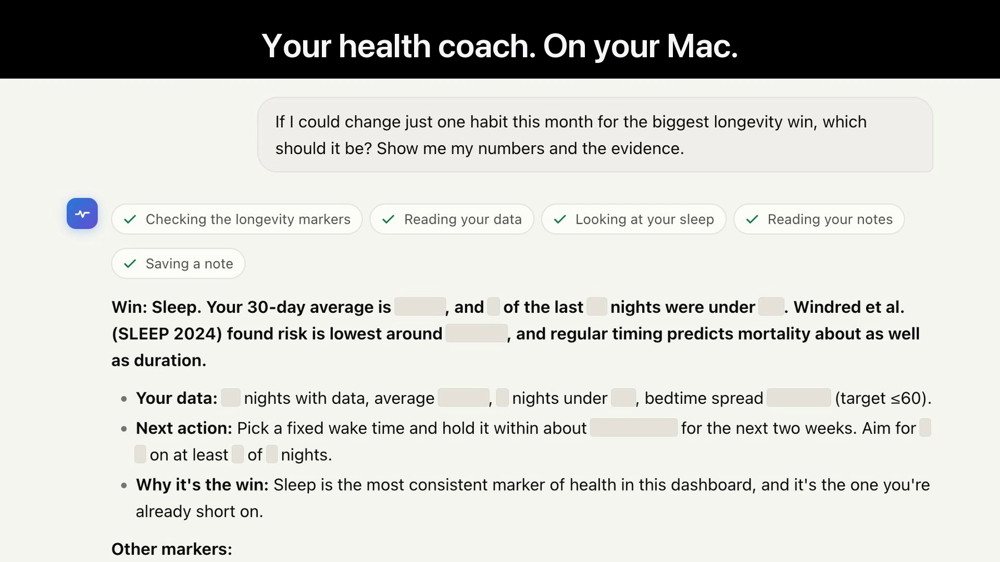

# health-llm

A private health coach that runs on a MacBook. Qwen3.5-0.8B, fine-tuned with LoRA in plain PyTorch to read your Apple Health data through tools, cite the research behind each target, and answer through a local OpenAI- or Claude-compatible API. Your data never leaves the machine.

[](docs/screenshots/coach-film.mp4)

<sub>▶ Click for the 35-second demo. Personal numbers are redacted.</sub>

## Results

112 held-out questions, same tools, same synthetic data:

| | Base Qwen3.5-0.8B | Fine-tuned |
|---|---|---|
| Finished an answer | 66% | **100%** |
| Malformed tool calls | 31% | **2%** |
| Passed every quality check | 46% | **93%** |
| Red flags referred to a clinician | 2 / 5 | **5 / 5** |
| Seconds per answer | 10.1 | **5.7** |

"Passed" means nothing was invented (every number traceable to a tool result, only real studies cited). It doesn't mean the answer was right; correctness grading is next. Cost: about $3 of Claude Haiku and a few hours of the Mac's GPU.

## How it works

```
1. Teacher    Claude Haiku answers 2,000 practice questions on synthetic data, with tools
2. Filter     quality.py drops chats with invented numbers, fake citations or missed red flags
3. Student    LoRA on Qwen3.5-0.8B learns from the 1,878 that pass (context distillation)
4. Serve      the student calls the same tools on your real data, on 127.0.0.1
```

The teacher never sees real health data. The student never sees the teacher's extra rules; it learns them from the examples.

## Quickstart

Needs an Apple Silicon Mac (built on an M4 Pro, 24 GB), [uv](https://docs.astral.sh/uv/), the `ant` CLI for generating data, and the [dashboard](../dashboard) next to this folder.

```bash
uv sync
ant auth login

uv run python -m healthllm.papers && uv run python -m healthllm.rag   # research corpus + search index
uv run python -m healthllm.generate questions                         # ~$0.10
uv run python -m healthllm.generate chats                             # ~$3, resumable
uv run python -m healthllm.train --run coach-0.8b                     # a few hours on MPS
HEALTH_LLM_ADAPTER=models/coach-0.8b/adapter uv run python -m healthllm.server
```

Then, in another terminal:

```bash
uv run coach "Am I on track?"
```

`DEMO=1` serves synthetic data. `HEALTH_LLM_ADAPTER=none` serves the untuned base model.

<details>
<summary>Calling the API</summary>

OpenAI format:

```python
from openai import OpenAI
client = OpenAI(base_url="http://127.0.0.1:8800/v1", api_key="unused")
reply = client.chat.completions.create(model="coach", messages=[{"role": "user", "content": "Am I on track?"}])
print(reply.choices[0].message.content)
```

Claude Messages format, with each tool the server runs streamed as a `server_tool_use` block:

```python
import anthropic
client = anthropic.Anthropic(base_url="http://127.0.0.1:8800", api_key="unused")
reply = client.messages.create(model="coach", max_tokens=400, messages=[{"role": "user", "content": "Am I on track?"}])
print(reply.content[0].text)
```

Both support `"stream": true`.
</details>

<details>
<summary>Evaluating and patching a weakness</summary>

```bash
uv run python -m healthllm.evaluate --base Qwen/Qwen3.5-0.8B --adapter none --name base-0.8b
uv run python -m healthllm.evaluate --base Qwen/Qwen3.5-0.8B --adapter models/coach-0.8b/adapter --name coach-0.8b
```

A reader found that *"Is my sleep improving? Only use last night's data."* got a week of data and a verdict. The fix was a new category of examples, a check on every claim, and a short continued run:

```bash
uv run python -m healthllm.generate questions --only too_little_data
uv run python -m healthllm.generate chats
uv run python -m healthllm.train --run coach-0.8b-v3 --init-adapter models/coach-0.8b/adapter \
    --focus too_little_data --replay 300 --epochs 1.5 --lr 1e-4
```

One-night questions passed went from 0 / 29 to 26 / 29. The catch: it now hedges more on ordinary questions. The [write-up](docs/WRITEUP.md#patch-is-it-improving-from-one-night) has the details.
</details>

## Code

| File | Does |
|---|---|
| [`generate.py`](src/healthllm/generate.py) | Haiku writes questions, then plays the Coach on synthetic data |
| [`quality.py`](src/healthllm/quality.py) | The filter: grounded numbers, known citations, tools used, referrals |
| [`chat_format.py`](src/healthllm/chat_format.py) | One prompt renderer for training and serving, plus label masking |
| [`train.py`](src/healthllm/train.py) | The PyTorch LoRA loop |
| [`evaluate.py`](src/healthllm/evaluate.py) | Before/after scores on held-out questions |
| [`agent.py`](src/healthllm/agent.py), [`server.py`](src/healthllm/server.py) | Tool loop and the local API |
| [`bridge.py`](src/healthllm/bridge.py), [`rag.py`](src/healthllm/rag.py), [`papers.py`](src/healthllm/papers.py) | Dashboard tools, paper search, paper download |

## Limits

- A 0.8B model handles one or two tool calls well. Date math ("the month before") and combining several numbers are where it slips.
- Tested on synthetic data. Real data has gaps and quirks the tests don't.
- Not medical advice. The clinician referral is a safety net, not a diagnosis.

## Read more

[`docs/WRITEUP.md`](docs/WRITEUP.md) is the full walk-through for someone who has never fine-tuned a model, mistakes included.

MIT licensed. `data/`, `models/` and `papers/` are gitignored.
